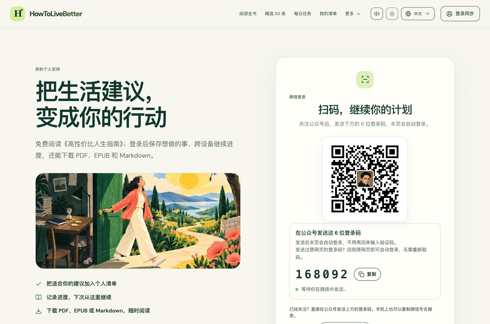
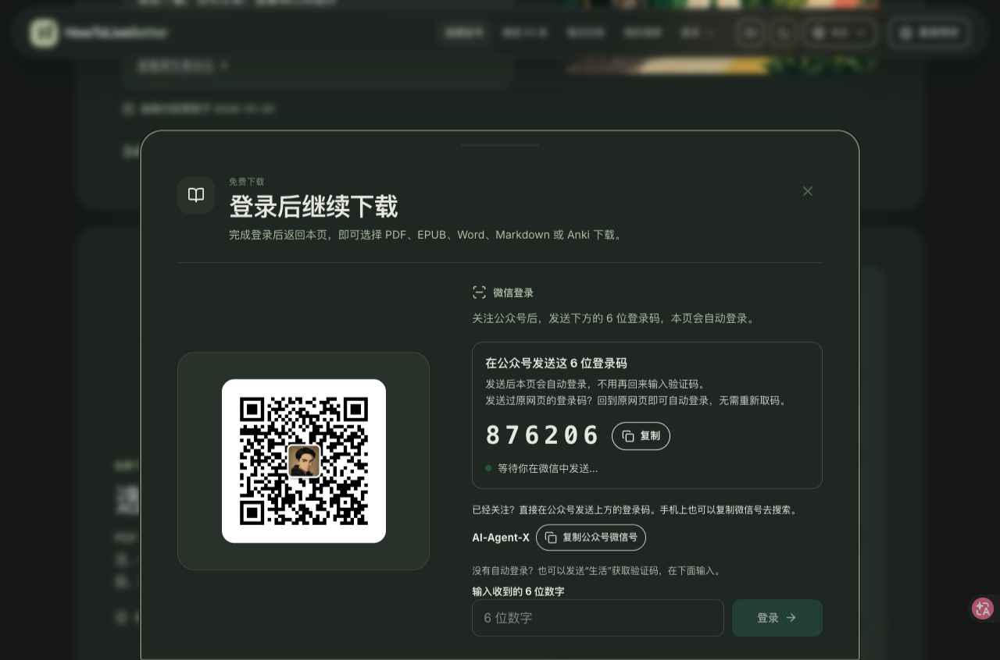
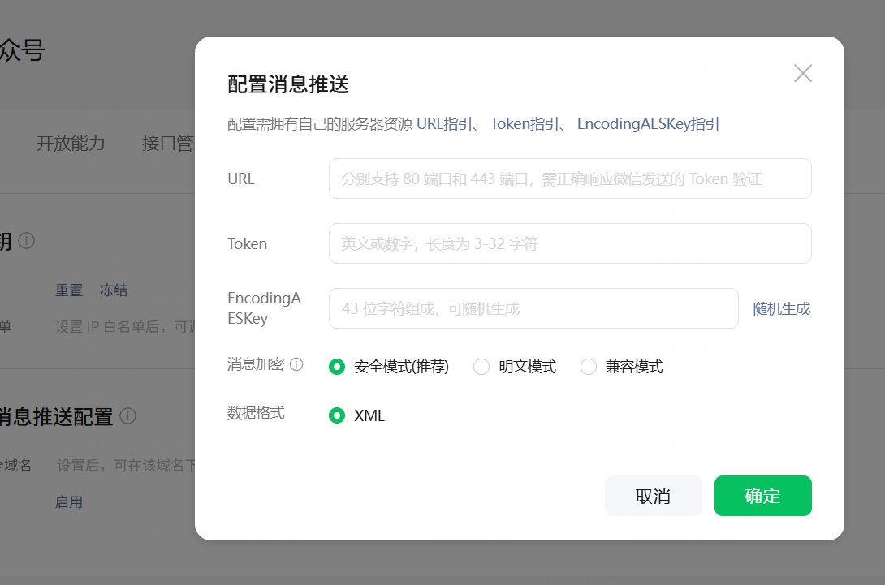

# website-to-wechat

把网站访客变成公众号粉丝的 Agent Skill：**公众号关注即登录**。

先看完整复盘：**[《我把网站用户转化到公众号，三周涨粉 2 万+（附开源 Skill）》](https://benx.ai/blog/posts/website-to-wechat-followers/)**。文章包含实际页面、入口数据和迭代过程；也可以到 [howtolivebetter.net](https://howtolivebetter.net) 体验阅读、下载和登录流程。

访客在网站上想下载 / 保存 / 同步，引导他用公众号登录：关注 → 发一个码 → 网站自动登录，继续刚才想做的事。只想拿资料的人，也可以在公众号回复关键词直接获取链接。

- ✅ 个人**未认证订阅号**可用（只用到消息推送，不需要认证服务号、开放平台网站应用、AppSecret）
- ✅ 桌面 / 手机浏览器 / 微信内置浏览器三条路径分别处理
- ✅ 一个公众号服务多个网站（关键词 + 命名空间隔离）
- ✅ 包含 howtolivebetter 的登录页、下载引导、同步提醒和操作文案，配有实际截图
- ✅ 附带生产代码提炼的参考实现：加解密、回调、配对码、限流、测试

## howtolivebetter 怎样设计登录与转化

这套做法从「用户现在想完成什么」开始。howtolivebetter 让访客先免费读书、标记建议；想把整本书带走，或跨设备继续进度时，再引导登录。

| 位置 | 实际设计 | 迁移到你的网站时可以怎么做 |
|---|---|---|
| 登录页 | 一侧说明个人清单、进度同步、离线下载，另一侧放二维码和登录码 | 先讲清登录后能完成什么，再给一个明确的操作步骤 |
| 下载入口 | 首页和章节末尾提供下载入口；点击格式后打开「登录后继续下载」面板 | 在用户主动索取内容时承接，登录后保留原来的下载选择 |
| 同步提醒 | 标记满 10 条后出现可展开的小入口，关闭后不再自动出现；同类主动提醒 7 天最多一次 | 用用户已经积累的进度说明同步价值，保留关闭和稍后再说 |
| 设备引导 | 桌面发码后自动登录；手机可复制登录码并打开微信；微信内发关键词、点登录链接 | 按用户所在的浏览环境给出能实际完成的步骤 |
| 登录完成 | 下载回到下载区域，清单继续留在原页面，本机进度合并进账号 | 把原来的任务接上，减少重新找页面、选格式和重做操作 |

### 登录页：把收益和步骤一起说清楚

页面用「把生活建议，变成你的行动」说明用途，再列出保存清单、继续进度、离线阅读。登录区告诉用户「关注公众号后，发送下方的 6 位登录码，本页会自动登录」，并显示复制按钮、等待状态和备用方式。



### 下载引导：在用户要拿内容的时候接住他

面板沿用网站的颜色、插画和排版，用「登录后继续下载」承接刚才的点击。用户看到自己将获得的格式，也知道登录后会回到哪里。微信内还提供「回复下载，直接拿链接」，需要同步进度时再登录。



完整的页面结构、提醒策略、三种环境的操作顺序、登录后续接，以及从网站代码提炼的组件职责，见 [登录与转化设计](references/login-design.md)。选择适合自己网站的入口，见 [漏斗设计与文案](references/funnel.md)。

## 真实数据

[howtolivebetter.net](https://howtolivebetter.net)（《高性价比人生指南》在线版），2026-10-02 上线公众号登录，到 10-21 共 19 天：

| 指标 | 数值 |
|---|---|
| 完成公众号登录 | **13,357 人** |
| 新用户中走微信登录 | 98% |
| 二维码曝光来自下载弹窗 | 72% |
| 一键登录链接打开 : 桌面配对成功（事件次数） | 6,279 : 2,982，约 2 : 1 |

这些数据用于理解入口和路径的使用情况。统计日期、来源及口径见 [案例记录](references/case-howtolivebetter.md)；逐环节检查流失的方法见 [埋点与转化率](references/analytics.md)。

## 安装

Claude Code：

```sh
git clone https://github.com/littleben/website-to-wechat ~/.claude/skills/website-to-wechat
```

Codex / 其他支持 Agent Skills 的工具：把仓库放进对应的 skills 目录即可。不用 Agent 也可以直接读 `SKILL.md` 照着做。

然后对 Agent 说：

> 用 website-to-wechat skill，给我的网站加上公众号登录。先分析我的网站和数据，找出用户最想要、值得用登录来换的东西。参考 howtolivebetter 的登录页、下载引导和同步提醒，提出入口、页面文案、三种浏览环境的操作步骤，以及登录后如何继续原任务，给我确认后再动手。

## 公众号消息推送配置

在微信公众号开发者后台进入「消息与事件推送」，打开「配置消息推送」。**EncodingAESKey 使用后台点击「随机生成」得到的 43 位密钥，不要让 AI 或本地脚本生成。** 将它原样复制到服务端环境变量 `WECHAT_MP_AES_KEY`，保持与后台一致；已有配置则沿用后台当前值。消息加密选择「安全模式」，数据格式选择 XML。



完整字段说明及启用前的自动回复迁移步骤见 [消息推送配置指南](references/webhook.md)。

## 目录

```
SKILL.md                       主流程（Agent 读这个）
assets/
  wechat-message-push-config.png  公众号消息推送配置截图
  howtolivebetter/              登录页、下载面板、同步提醒、微信内引导截图
references/
  login-design.md              登录页面、场景引导、提醒策略、任务续接与组件职责
  funnel.md                    诱饵、入口位置、三种环境的界面和文案
  webhook.md                   消息推送配置、迁移旧自动回复、5 秒与幂等、安全
  analytics.md                 漏斗埋点、GA 与数据库对账
  launch-checklist.md          真机验收清单
  case-howtolivebetter.md      完整文章入口、案例数据、设计迭代和踩坑
templates/
  wechat-crypto.mjs            安全模式加解密、签名、回复 XML
  webhook.mjs                  框架无关的回调处理（Request → Response）
  pairing.mjs                  验证码 / 配对码存储与限流（PostgreSQL）
  example-routes.mjs           Next.js 路由接法示例
  wechat-browser.ts            环境判断、记住返回页、轮询
  schema.sql                   新增表
  replies.zh-CN.json           旧自动回复迁移模板
  test/                        node:test（配对测试需要 TEST_DATABASE_URL）
```

## 跑测试

```sh
cd templates && npm install
npm test                                   # 加解密 + 回调
docker run --rm -d -p 55432:5432 -e POSTGRES_PASSWORD=pw --name wx-pg postgres:16
TEST_DATABASE_URL=postgres://postgres:pw@localhost:55432/postgres npm test   # 加上配对/验证码
```

## ⚠️ 启用前一定要知道

启用公众号「消息推送」后，**后台配置的自动回复和自定义菜单会立刻失效**。先把原文备份进 `replies.zh-CN.json`。

## 作者

Ben（[benx.ai](https://benx.ai) · [@littlebena](https://x.com/littlebena)），公众号「AI工具进化论」。

配套的公众号排版与发布 skill：[markdown-to-wechat](https://github.com/littleben/markdown-to-wechat)。

MIT License
