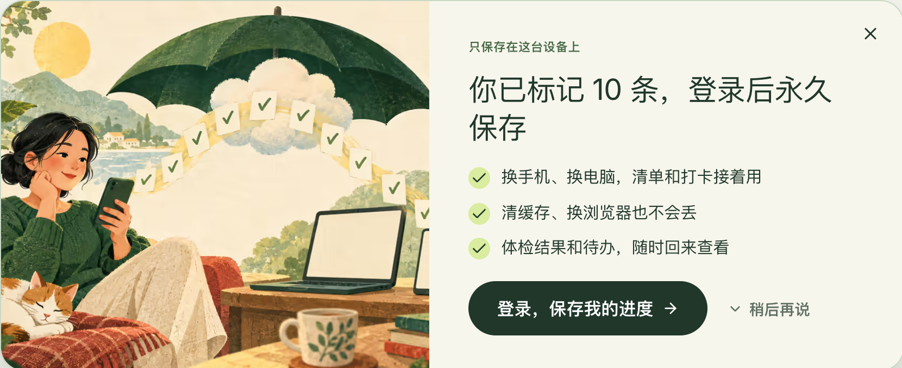
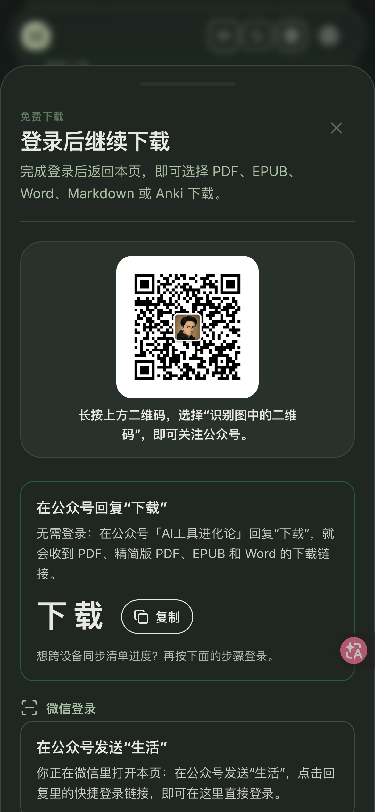

# 登录与转化设计：howtolivebetter 的实际做法

先看完整复盘：[《我把网站用户转化到公众号，三周涨粉 2 万+（附开源 Skill）》](https://benx.ai/blog/posts/website-to-wechat-followers/)。实际网站：[howtolivebetter.net](https://howtolivebetter.net)。本文结合文章截图和网站代码，整理可复用的页面结构与交互。

## 1. 先让访客获得价值，再承接下载和保存

howtolivebetter 让访客免费阅读、标记建议和加入待办。用户有内容想带走、或已经积累了一份清单时，下载和同步才有吸引力。

| 用户正在做的事 | 引导位置 | 登录后接着做什么 |
|---|---|---|
| 想离线阅读整本书 | 首页、章节末尾的下载入口，以及下载页的格式按钮 | 回到下载区域，提供刚才选择的格式 |
| 已标记了一批建议 | 可展开的同步入口、清单内的同步提示 | 将本机进度合并到账号，继续当前清单 |
| 刚导出清单、加入待办或完成体检 | 完成操作后的轻提示 | 同步已经产生的结果 |
| 主动点击登录 | 独立登录页 | 回到来源页，或进入个人空间 |

选你的网站里最有吸引力的任务作为主入口。howtolivebetter 的二维码曝光有 72% 来自下载弹窗，具体口径见 [案例记录](case-howtolivebetter.md)。

## 2. 独立登录页：收益说明与操作区各有重点

桌面页分为两个区域：

- **收益说明**：标题「把生活建议，变成你的行动」，下面说明可保存清单、跨设备继续进度、下载离线版。配图延续网站的生活主题，帮助用户理解这是同一个产品。
- **操作区**：标题「扫码，继续你的计划」，随后给出公众号二维码、6 位登录码、复制按钮、等待状态；已关注的用户直接发码即可，备用验证码和其他登录方式放在后面。

页面还保留「先看看整本书」，访客可以继续阅读。迁移时，换成你的网站真正提供的收益与预览入口。窄屏下保留清楚的阅读顺序，确保当前操作及其按钮容易找到。

## 3. 场景面板：文案接住刚才的点击

网站用同一套登录面板承接下载和同步，按场景改变标题、说明和返回位置。

| 场景 | 标题与说明 | 主操作之后 |
|---|---|---|
| 下载 | 「登录后继续下载」，列出可获取的 PDF、EPUB、Word、Markdown、Anki | 返回 `/book/download#download`，显示刚才选择的下载按钮 |
| 同步 | 「登录，把进度存到账号里」，说明清单、打卡和待办可跨设备继续 | 回到原页面，合并本机记录 |

面板有关闭按钮，关闭后保留原来的阅读位置和本机操作。颜色、边框、插画与文字层级沿用网站样式。用户在同一流程里就能看见自己要完成的事，以及登录后可以继续的步骤。

## 4. 同步提醒：用已经积累的进度说明价值

howtolivebetter 代码中的策略：

- 标记或收藏满 10 条后，先出现可展开的小入口，用户主动展开后才显示大卡片。
- 关闭状态保存在本机，后续访问不再自动打开；切换页面时，已展开卡片收起。
- 导出、加入待办、完成体检后的主动同步提示，共用 7 天冷却时间。
- 登录页、下载页等已有登录引导的位置隐藏底部入口，避免同一页面重复提醒。

提醒说清已有价值，例如「你已标记 10 条」「换手机、换电脑，清单和打卡接着用」，主按钮为「登录，保存我的进度」，同时提供「稍后再说」。

10 条和 7 天是这个网站的实际参数。其他产品应按用户产生可保存结果的频率选择触发点，并记录关闭、展开和完成情况。

## 5. 按浏览环境调整操作顺序

| 环境 | 优先展示 | 后续反馈与备用路径 |
|---|---|---|
| 桌面浏览器 | 二维码 + 可复制的 6 位登录码 | 「等待你在微信中发送…」→ 自动登录；失败时可用手动验证码 |
| 手机浏览器 | 登录码 +「复制登录码并打开微信」+ 搜索公众号的步骤 | 提示发码后回到原网页；下方保留二维码、复制微信号及相册识码说明 |
| 微信内置浏览器 | 二维码下的「长按识别」提示 + 短关键词 | 发送「生活」后点回复中的一键登录链接，带回原站内页面 |
| 微信内下载 | 可复制的「下载」关键词 | 公众号直接回复下载链接；有同步需要时继续登录 |

每条路径都写清楚「在哪里发什么，发完后去哪里」。已经关注的人直接发码；从原浏览器发起配对的人回原网页即可；过期和网络错误分别给出可执行的重试说明。二维码和详细步骤可参考 [漏斗设计与文案](funnel.md)。

## 6. 登录后继续原任务

howtolivebetter 的代码把这些状态分别处理：

1. **返回位置**：面板默认记住当前站内路径、查询参数和锚点；下载面板指定回下载区域。微信内通过短期 cookie 记住返回位置，一键链接登录后取回。
2. **下载选择**：点击格式时将格式名存入 `sessionStorage`。登录后重新检查下载权限，显示「已登录，继续下载刚才选择的格式」及对应按钮，由用户点击下载。
3. **本机进度**：游客记录先存本机。登录后读取云端记录，按条目与更新时间合并，服务端保存成功后才清理游客缓存；同步失败时保留本机数据。
4. **账号连续性**：已有账号的人先用原方式登录，再绑定微信，保留已有记录；合并账号要由用户确认。

返回路径只接受经过校验的站内地址，下载权限在服务端检查。文案中的「继续下载」「保存进度」要有对应的实现支撑。

## 7. 从网站代码提炼的模块职责

下面是 howtolivebetter 的实现结构。迁移时按职责接入你的网站已有框架，无需沿用同样的文件名。

| 网站中的模块 | 职责 | 迁移要点 |
|---|---|---|
| `src/routes/(auth)/sign-in.tsx` | 独立登录页、收益说明、其他登录方式、登录后跳转 | 保留来源目标，统一登录成功处理 |
| `src/components/auth-sheet.tsx` | 下载与同步共用的场景登录面板 | 用场景参数传入标题、说明和返回位置 |
| `src/components/book-download-auth-sheet.tsx`、`src/routes/book/download.tsx` | 下载入口、格式选择、权限检查、登录后继续下载 | 将待下载格式与账号会话分开保存 |
| `src/components/sync-prompt.tsx`、`src/lib/prompt-policy.ts` | 行为触发、折叠/关闭状态、提醒冷却 | 所有同类入口共用频率策略 |
| `src/components/wechat-pair-login.tsx` | 发起配对、复制与唤起微信、轮询、成功/过期/失败状态 | 按浏览环境选择路径，切回原网页继续领取 |
| `src/components/wechat-login-tools.tsx` | 二维码、长按提示、复制微信号、回复下载入口 | 二维码实际进入可视区域后再记录曝光 |
| `src/components/life-progress-provider.tsx` | 游客进度缓存、账号进度与云端合并 | 保存成功再清理游客数据，保留失败重试能力 |
| `src/lib/wechat-browser.ts`、`src/lib/redirect.ts` | 环境判断、返回目标校验和恢复 | 只接受站内返回路径 |
| `messages/zh.json` 及其他语言资源 | 页面收益、步骤、按钮、错误和无障碍文案 | 使用项目已有多语言框架与资源，按场景和语言选择登录方式 |

本仓库提供了配对与回调的[参考实现](../templates/)、[环境判断与返回位置示例](../templates/wechat-browser.ts)，页面按你的产品风格组合。收益、步骤、alt/aria、元数据和错误提示都放入现有语言资源。

## 8. 看用户有没有完成原来的事

分别检查：入口被看到 → 打开引导 → 开始登录 → 登录成功 → 点击所选下载格式 / 完成云端同步。还要看关闭提醒、取码失败、验证码错误，以及微信内链接打开后未完成登录的情况。

按入口、浏览环境和语言拆分结果，再决定先改哪个环节。案例中的设计可作为起点；具体指标及来源见 [埋点与转化率](analytics.md) 和 [案例记录](case-howtolivebetter.md)。
